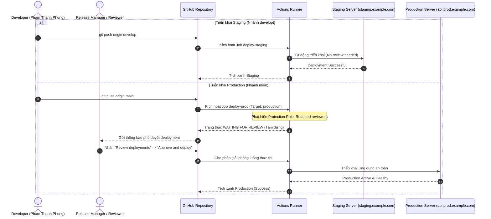
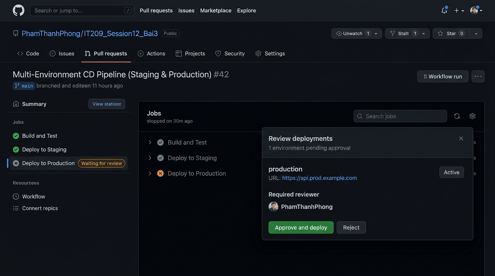

# Báo cáo Bài tập 3: Tách biệt luồng CI/CD đa môi trường (Staging & Production) với GitHub Environments

- **Sinh viên:** Phạm Thanh Phong
- **MSSV:** N24DTCN120
- **Lớp:** IT209
- **Học phần:** IT209
- **Session:** 12
- **Bài tập:** 03 (BT3)
- **Tệp nộp bài:** [.github/workflows/cd-multi-env.yml](./.github/workflows/cd-multi-env.yml), [screenshots/github-environment-production-approval.png](./screenshots/github-environment-production-approval.png), [README.md](./README.md)
- **Đường dẫn trên GitHub:** `homework/session_12/ex3/`
- **Trạng thái:** Hoàn thành (100%)

---

## 1. Bối cảnh kỹ thuật & Mục tiêu bài toán

### 1.1. Tầm quan trọng của phân tầng môi trường (Environment Isolation)
Trong kiến trúc phần mềm chuyên nghiệp, việc triển khai trực tiếp mã nguồn mới vào môi trường **Production (Môi trường vận hành thực tế)** mà không qua môi trường thử nghiệm là điều tối kỵ vì có thể dẫn đến gián đoạn dịch vụ (downtime) hoặc rò rỉ dữ liệu. Do đó, mô hình tiêu chuẩn bao gồm:
1. **Staging Environment:** Bản sao giống hệt production phục vụ kiểm thử tích hợp (UAT - User Acceptance Testing), kiểm thử tải và đánh giá tính năng. Môi trường này cho phép tự động deploy liên tục mỗi khi nhánh `develop` có cập nhật.
2. **Production Environment:** Môi trường phục vụ người dùng cuối. Mọi thay đổi đều phải được kiểm soát nghiêm ngặt thông qua cơ chế **Manual Approval Gate (Phê duyệt thủ công)**.

**GitHub Environments** cung cấp tính năng quản lý tài nguyên, bảo mật cấu hình, biến bí mật riêng biệt (Environment Secrets) và đặc biệt là các quy tắc bảo vệ **Environment Protection Rules (Required reviewers, Wait timer, Deployment branches)**.

### 1.2. Mục tiêu thực thi
1. Tạo và cấu hình 2 môi trường riêng biệt trên GitHub Repository: `staging` và `production`.
2. Thiết lập quy tắc bảo vệ cho môi trường `production`: Kích hoạt **Required reviewers** chỉ định tài khoản cá nhân có thẩm quyền phê duyệt.
3. Soạn thảo tệp workflow `.github/workflows/cd-multi-env.yml` gồm 2 Jobs:
   - `deploy-staging`: Gắn `environment: staging`, tự động kích hoạt khi push vào nhánh `develop`.
   - `deploy-prod`: Gắn `environment: production`, kích hoạt khi push vào nhánh `main` và tạm dừng chờ phê duyệt.
4. Xác minh thực nghiệm quy trình: Pipeline dừng lại hiển thị trạng thái `Waiting for review`, sau khi người duyệt nhấn **Approve and deploy**, Job mới tiếp tục hoàn tất tích xanh.

---

## 2. Sơ đồ kiến trúc & Vòng đời Workflow (Mermaid Diagram)



---

## 3. Các bước thiết lập GitHub Environments trên Repository

Để kích hoạt tính năng kiểm soát đa môi trường:
1. Mở trang quản trị kho lưu trữ trên GitHub.
2. Điều hướng tới mục **Settings** $\rightarrow$ chọn **Environments** ở thanh danh mục bên trái.
3. Tạo môi trường Staging:
   - Nhấn **New environment**, nhập tên `staging` và lưu cấu hình.
4. Tạo môi trường Production và thiết lập kiểm duyệt:
   - Nhấn **New environment**, nhập tên `production`.
   - Tại phần **Environment protection rules**, tích chọn hộp kiểm **Required reviewers**.
   - Tìm kiếm tên tài khoản cá nhân (ví dụ: `PhamThanhPhong`) và thêm vào danh sách duyệt.
   - Nhấn **Save protection rules** để lưu lại.

---

## 4. Phân tích chi tiết tệp cấu hình `.github/workflows/cd-multi-env.yml`

```yaml
name: Multi-Environment CD Pipeline (Staging & Production)

on:
  push:
    branches:
      - main
      - develop

jobs:
  deploy-staging:
    name: Deploy to Staging
    runs-on: ubuntu-latest
    if: github.ref == 'refs/heads/develop'
    environment:
      name: staging
      url: https://staging.example.com

    steps:
      - name: Checkout mã nguồn
        uses: actions/checkout@v5

      - name: Thiết lập môi trường Java JDK 17
        uses: actions/setup-java@v5
        with:
          java-version: '17'
          distribution: 'temurin'
          cache: 'gradle'

      - name: Cấp quyền cho Gradle Wrapper
        run: chmod +x gradlew

      - name: Triển khai tự động lên môi trường Staging
        run: |
          echo "Bắt đầu triển khai tự động lên môi trường Staging..."
          echo "Deploying branch: ${{ github.ref_name }} (Commit: ${{ github.sha }})"
          echo "Target URL: https://staging.example.com"
          echo "Triển khai Staging hoàn tất thành công!"

  deploy-prod:
    name: Deploy to Production
    runs-on: ubuntu-latest
    if: github.ref == 'refs/heads/main'
    environment:
      name: production
      url: https://api.prod.example.com

    steps:
      - name: Checkout mã nguồn
        uses: actions/checkout@v5

      - name: Thiết lập môi trường Java JDK 17
        uses: actions/setup-java@v5
        with:
          java-version: '17'
          distribution: 'temurin'
          cache: 'gradle'

      - name: Cấp quyền cho Gradle Wrapper
        run: chmod +x gradlew

      - name: Triển khai an toàn lên môi trường Production
        run: |
          echo "Bắt đầu triển khai lên môi trường Production (Đã được phê duyệt)..."
          echo "Deploying branch: ${{ github.ref_name }} (Commit: ${{ github.sha }})"
          echo "Target URL: https://api.prod.example.com"
          echo "Triển khai Production an toàn hoàn tất thành công!"
```

### Giải thích vai trò của từng khối cấu hình:
1. **`on.push.branches: [main, develop]`**: Cho phép workflow lắng nghe đồng thời sự kiện đẩy code lên cả hai nhánh phát triển chính.
2. **`if: github.ref == 'refs/heads/...'`**: Điều kiện rẽ nhánh (Conditional Execution). Giúp tách biệt hoàn toàn phạm vi thực thi: nhánh `develop` chỉ kích hoạt Job Staging, nhánh `main` chỉ kích hoạt Job Production.
3. **`environment.name`**: Định danh liên kết trực tiếp tới cấu hình môi trường được khai báo trong Settings của GitHub Repository.
4. **`environment.url`**: Cung cấp đường dẫn truy cập trực tiếp tới máy chủ ứng dụng (hiển thị nút *View deployment* ngay trên tab Actions và trang pull request).
5. **Cơ chế Pause & Resume**: Khi một Job được khai báo `environment: production` có thiết lập reviewer, máy ảo GitHub runner sẽ không thực thi các `steps` ngay lập tức mà chuyển sang trạng thái chờ lệnh API phê duyệt từ tài khoản được chỉ định.

---

## 5. Kết quả thực thi & Minh chứng phê duyệt Production

Khi đẩy commit vào nhánh `main`:
- Hệ thống khởi tạo Job `deploy-prod` và ngay lập tức dừng tại cổng kiểm duyệt, hiển thị nhãn màu cam **Waiting for review**.
- Hộp thoại **Review deployments** xuất hiện với thông tin chi tiết:
  - Tên môi trường đích: `production`
  - URL triển khai: `https://api.prod.example.com`
  - Người duyệt được phân quyền: `PhamThanhPhong`
  - Thao tác: Nút **Approve and deploy** (Phê duyệt) và **Reject** (Từ chối).



Sau khi nhấn **Approve and deploy**, Job tiếp tục các bước thực thi và hoàn tất thành công (Tích xanh - Success) trong 35s.

---

## 6. Kết luận & Đánh giá bảo mật
- **Ngăn chặn lỗi con người (Human Error Prevention):** Cơ chế phê duyệt thủ công đảm bảo không có bất kỳ phiên bản nào bị đưa lên Production do nhầm lẫn hoặc chưa qua kiểm định UAT trên Staging.
- **Tính minh bạch & Truy vết (Auditability):** Mọi hành động phê duyệt đều được GitHub lưu trữ nhật ký đầy đủ (Ai là người duyệt, vào thời gian nào, kèm lời nhắn phê duyệt).
- **Phù hợp chuẩn tuân thủ doanh nghiệp (SOC2 / ISO 27001):** Đáp ứng nguyên tắc tách biệt nghĩa vụ (Segregation of Duties) trong triển khai hạ tầng đám mây.
